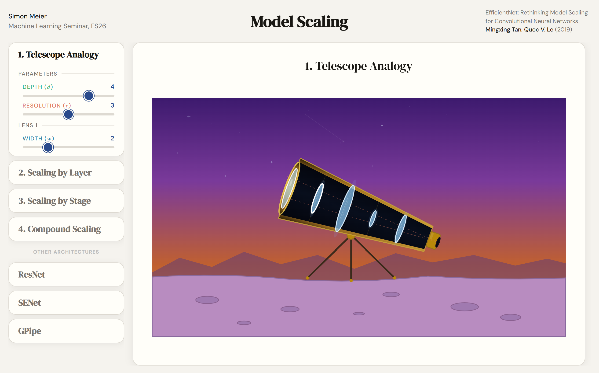

# CapySlides

Presentations as **single, offline HTML files** in the ETH Zürich style: slides with step-by-step
reveals, LaTeX formulas, reusable building blocks and interactive animations — opened by
double-click, presented from the browser, submitted as one zip.

- **Self-contained:** each presentation is a folder (deck + animations + images) that works offline
  and never depends on this repository.
- **Writes like HTML, presents like PowerPoint:** steps per slide, slide navigator with live previews,
  remembered step per slide, animation overlays, automatic slide numbers, date and footer.
- **Hard to break:** missing images or animations become labelled placeholders, and a `?dev` mode plus
  `tools/check.py` list every problem with its slide and step.
- **AI-ready:** `AUTHORING.md` and a `CLAUDE.md` in every project tell an AI assistant exactly how to
  write and check slides.

## Showcase

**[Click through a real talk made with CapySlides](https://simba380.github.io/CapySlides/)**, right in
the browser, nothing to install: → / Space for the next step, **D** / **A** inside an animation.

[](https://simba380.github.io/CapySlides/EfficientNet/EfficientNet_presentation.html)

**[EfficientNet: Rethinking Model Scaling for CNNs](https://simba380.github.io/CapySlides/EfficientNet/EfficientNet_presentation.html)**,
a seminar talk with 21 slides, 5 of them interactive animations. Its source is in
[`showcase/EfficientNet/`](showcase/EfficientNet/) and shows how slides, steps, components and
animations are written. It contains only material that may be published: own illustrations, freely
licensed photos (credited on the slides) and charts redrawn from the paper's published numbers instead
of the paper's figures. More talks will follow.

---

## Requirements

| What | Why |
|---|---|
| **Chrome or Edge** (any current version) | Viewing and presenting; `check.py` / `pack.py` run it headless |
| **Python 3.10+** (no packages needed) | The tools in `tools/` |
| Internet | Not needed (fonts and KaTeX are built into every deck) |

## Quick start

```bash
python tools/new.py MyTalk
```

1. **Create** — `new.py` asks for title, subtitle, presenter, course, semester and (optionally) the
   names of animations, then creates `presentations/MyTalk/`.
2. **Write** — open `presentations/MyTalk/MyTalk_presentation.html` in a text editor and edit the slides
   (see `AUTHORING.md`, or let an AI assistant do it — see below). Put images into `images/`.
3. **Look** — open the same file in Chrome/Edge with `?dev` at the end of the address
   (`…/MyTalk_presentation.html?dev`): problems are listed in **☰ Slides**, all building blocks in
   **▦ Components**.
4. **Check** — `python tools/image_sizes.py presentations/MyTalk/MyTalk_presentation.html` after adding
   images, then `python tools/check.py presentations/MyTalk` (✓ no problems = ready).
5. **Present** — open the file (without `?dev`), press **F11** for fullscreen, use → / ← (or a clicker).
6. **Submit** — `python tools/pack.py presentations/MyTalk` writes `presentations/MyTalk.zip`
   (only the presentation files; verified to work on its own).

Another animation later: `python tools/add_animation.py presentations/MyTalk "Model Scaling"` creates the
file and registers it in the deck.

Every command with all options: **`TOOLS.html`** (open it in the browser).

## Presenting

| Key / button | Action |
|---|---|
| → ↓ Space PageDown End | next step, then next slide (clickers/laser pointers work) |
| ← ↑ PageUp Home | previous step / slide |
| D / A | one step forward / back inside the animation that is visible (animation slide or open animation); the slides do not move |
| ☰ Slides | all slides with previews; click to jump (each slide remembers its step) |
| ▶ Animation / ▶ Animations | open the interactive animation(s); ◀ Presentation / ⇄ Switch to go back |
| Esc | close a panel |
| F11 | fullscreen — on your laptop the text then has exactly the sizes of the original deck |

The slides are a fixed 1280 × 800 (16:10) canvas, scaled to the screen: they look identical on the
laptop and on a mirrored beamer.

## Working with an AI assistant

Open the project folder (`presentations/MyTalk/`) or this repository in Claude Code. The `CLAUDE.md`
files tell the assistant where the guide is, which part of the file it may edit, and that it must run
`tools/check.py` after every change. Useful requests:

- "Create slides 3–8 for my talk on <paper>: motivation, method, results. Use the components."
- "Add an image slide for `images/results.png`; reveal the red marker line on the second click."
- "Turn this table into a `data-table` and highlight the rows of our model."
- "Run check.py and fix every problem."
- "Add a new animation panel that shows …" (in `<name>_animations.html`)

## Updating to a newer template

The engine inside each deck has a version (`engine/VERSION`; the deck shows it in its
`DECK-ENGINE:BEGIN v…` marker). After pulling a newer version of this repository:

```bash
python tools/update.py presentations/MyTalk
```

Only the generated engine blocks change (backups `*.bak` are written); your slides stay untouched.
Within 1.x updates never change the meaning of existing attributes.

## Publishing a talk in the showcase

Everything inside `presentations/` (and `docs/`) stays on your machine: only the folders' README is
in git, so your talks are never pushed by accident. To publish one as an example on the website:

```bash
python tools/showcase.py presentations/MyTalk --preview results
```

It copies only the files the talk uses to `showcase/MyTalk/` (checked offline first; nothing is
published if there are problems), takes a screenshot of the chosen slide (`--preview`: slide id or
number, remembered) and rewrites `showcase/index.html`. The showcase copy is public, so it may only
contain material you may publish: edit it in place (e.g. replace paper figures) and refresh it with
`python tools/showcase.py showcase/MyTalk`; your own project stays as it is (overwriting the copy from
it again needs `--replace`). Commit and push `showcase/`; the workflow
`.github/workflows/showcase.yml` then publishes it with GitHub Pages. One-time setup on GitHub:
**Settings → Pages → Source: GitHub Actions**.

## Troubleshooting

| Symptom | Cause and fix |
|---|---|
| Text looks smaller than in my old deck | The browser window is not fullscreen (toolbars take height, the 16:10 slide shrinks). Press F11. |
| White box `image "x.png" not found` | The file is not in `images/` (or the path/name differs). Fix the path, then run `image_sizes.py`. |
| White box `animation "x.html" not found` | The file is missing, its name differs from `DECK.animations`, or it lost its `ANIM-CONTRACT` block. Start animations from `template/template_animations.html`. |
| A formula is red | KaTeX cannot parse it; `check.py` shows the error. For a literal dollar sign write `\$`. |
| Content appears one click late / early | Steps are 0-based: `data-step="0"` = with the title; unmarked content comes last (AUTHORING.md §5). |
| Arrow keys move a slider instead of the slide | Inside animations arrow keys go to the presentation; hold Ctrl or Shift to move only the slider. |
| `check.py`: "no working Chrome/Edge found" | Install Chrome, or set `DECK_TEST_BROWSER` to the browser's .exe. A browser in the middle of an update can fail headless — the tools then try the next one. |
| The zip shows broken images | Extract the zip before opening the deck (browsers can't read files inside a zip). |
| Something in the engine block was edited by mistake | `python tools/update.py <folder>` rewrites the engine blocks from the repository (also at the same version); your slides stay untouched. |

## Repository map

| Path | Content |
|---|---|
| `presentations/` | Your presentation projects (one self-contained folder each; only its README is committed) |
| `docs/` | Your own reference material (only its README is committed) |
| `showcase/` | Published example talks + `index.html`, served by GitHub Pages (written by `showcase.py`) |
| `template/` | The generated starter deck and starter animation (`new.py` copies them) |
| `tools/` | `new`, `add_animation`, `check`, `image_sizes`, `update`, `pack`, `showcase`, `build`, `fetch_vendor` + tests |
| `engine/` | Source of the engine (JS/CSS), components, starter shells, vendored fonts/KaTeX |
| `.github/workflows/` | `showcase.yml`: deploys `showcase/` to GitHub Pages |
| `AUTHORING.md` | How to write slides (for people and AI) |
| `TOOLS.html` | Every command and in-browser helper |
| `SPEC.md` | Design, phases and the decision log |
| `CLAUDE.md` | Rules for AI agents working in this repository |

## Credits

- Default title-slide photo (`engine/assets/eth_zurich_main_building.jpg`, the ETH Zurich main
  building): Josip Ivanković on [Unsplash](https://unsplash.com/photos/yZW-3LPsss8), used under the
  [Unsplash License](https://unsplash.com/license). New decks show this credit on the title slide
  (`DECK.cover.credit`).
- Showcase EfficientNet, resolution slide: photo by Henrique Ferreira on
  [Unsplash](https://unsplash.com/photos/zPR3-g7ECHE) (Unsplash License).
- Fonts: Inter, Fira Code and DM fonts (SIL Open Font License 1.1); math: KaTeX (MIT). Their licence
  files are in `engine/vendor/`.

## Development

```bash
python tools/build.py                     # regenerate template/ and AUTHORING.md from engine/
python -m unittest discover tools/tests   # build, engine (headless browser) and tool tests
```

Change engine behaviour only in `engine/`, bump `engine/VERSION`, record decisions in `SPEC.md` §20.
